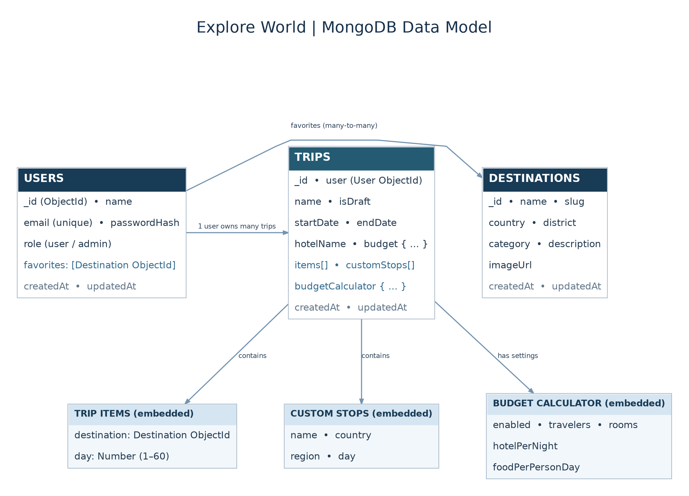
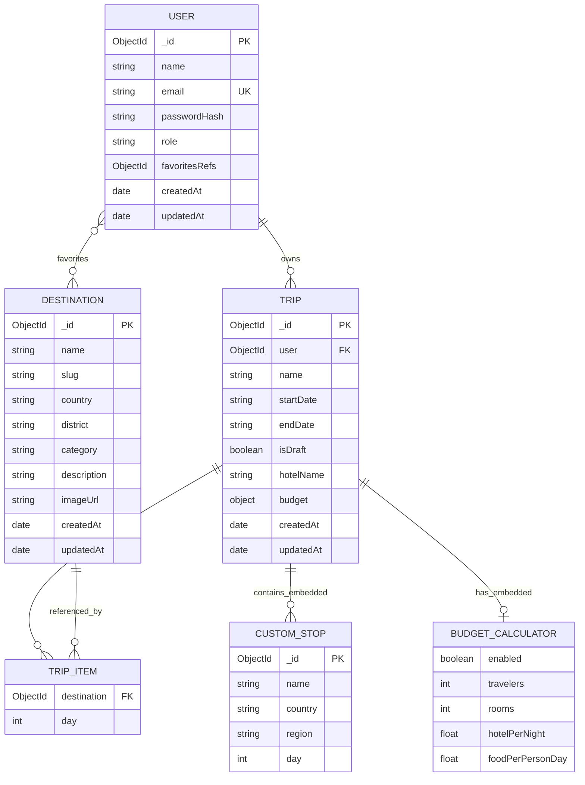

# Explore World — Database ER Diagram

The application uses **MongoDB Atlas** with **Mongoose**. It has three primary collections: `users`, `destinations`, and `trips`. References are MongoDB ObjectIds, not SQL foreign keys.

## Relationship diagram (Mermaid)

## Collection relationships

| Relationship | Implementation |
| --- | --- |
| **User → Trips** | Each Trip contains a `user` ObjectId referencing its owner (`User._id`); one user can own many trips. |
| **User ↔ Destinations (Favorites)** | Each User has a `favorites` array of Destination ObjectIds. A destination can be favorited by many users. No separate Favorites collection exists. |
| **Trip → Trip items → Destinations** | Trip `items` is an **embedded array**; each entry stores a Destination ObjectId and a planned day. The items are not stored in a separate MongoDB collection. |
| **Trip → Custom stops** | Trip `customStops` is an **embedded array** of personal places (`name`, `country`, `region`, `day`). These do not appear in the public Destinations collection. |
| **Trip → Budget and calculator** | `budget` and `budgetCalculator` are **embedded objects** in Trip, not separate collections. Budget values cover accommodation, food, transport, and activities. Calculator settings store traveler count, room count, nightly hotel rate, and daily food rate. |

### Important notes

- The models are defined in `backend/src/models/User.js`, `Destination.js`, and `Trip.js`.
- `User.email` is unique. Destination has an index on `(country, slug)`. Trips have an index on `(user, updatedAt)`.
- In the ER diagram, `TRIP_ITEM`, `CUSTOM_STOP`, and `BUDGET_CALCULATOR` are **logical embedded structures**, not standalone database tables or collections.
- Trip dates are stored as ISO-style date strings (`YYYY-MM-DD`) in the Trip model.
- The destination seed script starts with 25 places in five countries; the live count may grow when admins add records.

**Use in the mini-project report:** Insert [ExploreWorld_ERD.png](ExploreWorld_ERD.png) as the database design figure. This depicts the relationships implemented in your code, rather than an invented relational SQL schema.
